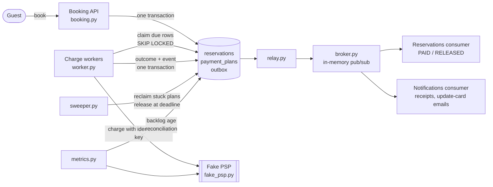

# rnpl-mini: Reserve Now, Pay Later, small enough to read in one sitting

A compact, fully working **deferred-payment scheduler**. A guest books a stay for $0 today, and the system charges their card automatically before the free-cancellation deadline. It retries soft declines, asks for a new card after hard ones, and releases the reservation if payment never arrives.

It's about 1,300 lines of heavily commented Python and one Postgres database. Postgres also does the jobs that a production system would hand to Redis, Kafka and Kubernetes, so every correctness mechanism is visible in one place.

**Stack:** Python 3.11+ · PostgreSQL 16 · psycopg 3 (raw SQL, no ORM) · FastAPI · pytest · Docker Compose

## The two rules it guarantees

1. **Never charge a guest twice**, even with many concurrent workers, workers crashing mid-charge, or processor timeouts.
2. **Never leave a reservation unpaid past its deadline.** A sweeper and a reconciliation check catch anything that slips through.

There are 18 failure-injection tests, and each one tells the story of how a rule could break and why it doesn't. Examples include `test_many_workers_never_double_charge`, `test_worker_crash_after_charge_is_replayed_not_recharged`, `test_processor_timeout_retries_with_same_key`, `test_cancel_during_charge_is_refunded` and `test_reconciliation_catches_money_without_a_booking`.

## Patterns it demonstrates

| Pattern | Where |
| --- | --- |
| Work claiming with `SELECT … FOR UPDATE SKIP LOCKED` and a partial index on due rows | `app/worker.py`, `schema.sql` |
| Idempotency keys per charge attempt (`plan-<id>-attempt-<n>`): reuse after an unknown outcome, new key after a definite decline | `app/worker.py`, `app/fake_psp.py` |
| Transactional outbox → relay → consumers (at-least-once, idempotent handlers) | `app/outbox.py`, `app/relay.py`, `app/consumers.py` |
| Optimistic concurrency (`version` + compare-and-set) | `app/plans.py` |
| Leases and a sweeper for crashed workers; deadline-based release | `app/sweeper.py` |
| Time-zone-correct deadlines (listing-local, stored in UTC, DST-safe) and an injectable clock | `app/timeutil.py`, `app/clock.py` |
| Soft vs. hard decline retries, sized to fit the deadline buffer | `app/config.py`, `app/worker.py` |
| Fail-closed booking (reservation, plan and event in one transaction) | `app/booking.py` |
| Observability: backlog age and reconciliation against processor records | `app/metrics.py` |

## Architecture



**For a full walkthrough, see [GUIDE.md](GUIDE.md).** It covers every file and dependency, the plan state machine, where each transaction starts and ends, deep dives on each pattern, what's left out on purpose, and exercises.

## Run it

```bash
# 1. Postgres
docker compose up -d

# 2. Python deps (3.11+)
python -m venv .venv && source .venv/bin/activate
pip install -r requirements.txt

# 3. Tables + sample listings
python -m app.cli init-db

# 4a. The narrated tour (fastest way to see everything)
python demo.py

# 4b. The failure-injection tests (WIPE the database)
pytest -v

# 4c. Or run it "for real": two terminals
python -m app.cli all                 # 2 workers + sweeper + relay
uvicorn app.api:app --reload          # http://localhost:8000/docs
```

Then, in the Swagger UI at `/docs`:
1. `POST /reservations` with a check-in about 20 days out and `card_token: "tok_expired"`
2. `POST /dev/clock/advance` with `{"days": 18}` (jump past `charge_at`)
3. `GET /reservations/1`: plan is `NEEDS_NEW_CARD`, with an email asking for a new card
4. `POST /reservations/1/card` with `{"card_token": "tok_ok"}`, wait 2 seconds, then `GET` again: `PAID`
5. `GET /metrics`

Card tokens: `tok_ok`, `tok_insufficient_funds`, `tok_flaky`, `tok_expired`, `tok_stolen`, `tok_timeout`.
Listings: 1 Brooklyn (USD, flexible), 2 Paris (EUR, moderate), 3 Tokyo (JPY, flexible),
4 Aspen (strict, not eligible), 5 São Paulo (BRL, not eligible).
